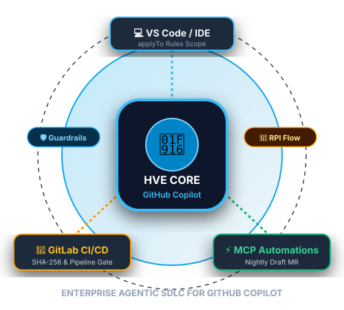
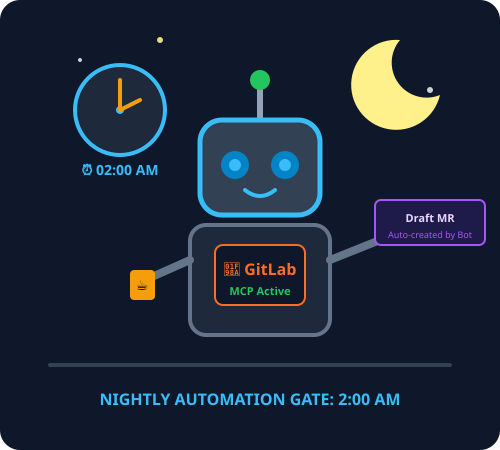

<!-- Slide 1: Cover -->
<!-- _class: middle -->

FPT SOFTWARE · AI ENGINEERING
<h1 style="font-size: 44px; line-height: 1.25; margin-bottom: 14px;">HVE Core × GitHub Copilot</h1>
<h3 style="color: #f59e0b; font-size: 26px; line-height: 1.35; margin-bottom: 22px;">
Chuẩn hóa Coding Conventions cho GitHub Copilot từ IDE đến GitLab
</h3>

📏 Instructions theo <code>applyTo</code>
🔁 RPI Workflow
⏰ Copilot Automations + GitLab MCP
🧠 Harness² tự học quy chuẩn

Bộ quy chuẩn (Guardrails) đóng gói sẵn cho doanh nghiệp: Dễ dàng tùy biến, áp dụng ngay cho từng dự án.

---

<!-- Slide 2: Problem/Context -->
## 1. Copilot viết đoạn này trong 3 giây. Bạn có duyệt không?

<pre style="background: #020617; border: 1px solid #334155; border-radius: 10px; padding: 14px 18px; font-size: 19px; line-height: 1.45; margin: 0;"><code>data class PaymentReq(
    val userId: String,
    val cardNumber: String,
    val cvv: String,
    val amount: Double,
    val note: String,
)
// …
logger.info("Start payment: $req")</code></pre>

INFO Start payment: PaymentReq(userId=…, <b>cardNumber=4111111111111234, cvv=123</b>, …)

<ul style="font-size: 19px;">
<li>Code biên dịch thành công, Unit Test pass, nhìn qua tưởng như ổn.</li>
<li>Nhưng log in lộ toàn bộ <b>số thẻ + CVV</b>, còn tiền tệ tính bằng <code>Double</code> (sai số làm tròn).</li>
<li>Copilot không sai về cú pháp. Nó chỉ <b>chưa được định hướng theo chuẩn của dự án</b>.</li>
<li>Mỗi dự án lại tự viết prompt thủ công → Tốn thời gian, thiếu đồng nhất, dễ bị chệch hướng (<b>Prompt Drift</b>).</li>
</ul>

💡 <b>Tránh lãng phí công sức (Reinventing the wheel):</b> Microsoft đã tối ưu sẵn bộ khung chuẩn dành riêng cho Copilot.

---

<!-- Slide 3: Giới thiệu HVE Core -->
## 2. HVE Core là gì? Bộ khung chuẩn từ Microsoft cho Copilot

<b>Hypervelocity Engineering Core</b> (<code>microsoft/hve-core</code>): bộ <b>instructions, prompts, agents, skills</b> viết sẵn cho GitHub Copilot.

<ul style="font-size: 19px;">
<li>🔁 <b>RPI Workflow:</b> <code>/rpi-research</code> → <code>/rpi-plan</code> → <code>/rpi-implement</code> → <code>/rpi-review</code>.</li>
<li>🛠️ <b>HVE Builder (<code>/hve-builder</code>):</b> Tự động nhân bản và tùy chỉnh pattern phù hợp với Stack của dự án.</li>
<li>🛡️ <b>Security Instructions:</b> Tham chiếu OWASP/NIST, an toàn chuỗi cung ứng, dependency review.</li>
<li>💡 <b>Mở rộng:</b> Tích hợp sẵn Design Thinking Coach (<code>dt-coach</code>) và Skill khởi tạo Slide (<code>hve-slides</code>)…</li>
</ul>

Cài đặt linh hoạt qua Extension VS Code <code>ise-hve-essentials.hve-core</code> hoặc Plugin Copilot CLI.

---

<!-- Slide 4: Cơ chế applyTo -->
## 3. Cơ chế hoạt động: Quy chuẩn theo ngữ cảnh (Context-Aware Rules)

<pre style="background: #020617; border: 1px solid #334155; border-radius: 10px; padding: 10px 14px; font-size: 16px; line-height: 1.4; margin: 0 0 10px 0;"><code>---
applyTo: "payment-backend/**/*.scala,
  payment-backend/**/*.kt,
  frontend/src/**/*.ts, .gitlab-ci.yml"
---
### 1. Backend: che số thẻ trong toString(),
###    blocking I/O → Dispatchers.IO
### 2. Angular: cấm bypassSecurityTrustHtml,
###    OnPush + takeUntilDestroyed()
### 3. GitLab CI: image ghim @sha256,
###    không echo secret</code></pre>

File <code>.github/instructions/company-security-stack.instructions.md</code> trong demo.

<ul style="font-size: 19px; margin-top: 5px;">
<li>Mở <code>.kt</code> → Kích hoạt quy chuẩn Backend. Mở <code>.ts</code> → Kích hoạt quy chuẩn Frontend.</li>
<li>Quy chuẩn lưu trực tiếp trong Git repo: Review qua Merge Request, có version history, cả team dùng chung.</li>
<li><b>Custom Instructions chỉ định hướng cho AI sinh code đúng, không thay thế hoàn toàn SAST/CI Scanner.</b> Vẫn cần Code Review và CI Pipeline.</li>
</ul>

---

<!-- Slide 5: RPI Workflow -->
## 4. RPI Workflow: Tránh việc AI can thiệp code trực tiếp mà thiếu kiểm soát

BƯỚC 1
<h3 style="color: #38bdf8;">🔍 Research <code>/rpi-research</code></h3>

Khảo sát chỉ đọc: Phân tích cấu trúc repository, API và các ràng buộc kỹ thuật trước khi sửa code.

BƯỚC 2
<h3 style="color: #fbbf24;">📋 Plan <code>/rpi-plan</code></h3>

Lập kế hoạch dạng Markdown, tích hợp bước tự đánh giá (Self-Validation). Cần Tech Lead phê duyệt trước khi thực thi.

BƯỚC 3
<h3 style="color: #34d399;">⚡ Implement <code>/rpi-implement</code></h3>

Thực thi chính xác theo kế hoạch đã duyệt, chạy Unit Test để kiểm chứng kết quả.

BƯỚC 4
<h3 style="color: #c084fc;">🛡️ Review <code>/rpi-review</code></h3>

Đối chiếu kết quả thực thi với Kế hoạch &amp; Standard. (Demo sử dụng <code>/hve-review</code> được customized cho dự án).

---

<!-- Slide 6: Fork & Own -->
## 5. ⚠️ Khuyến cáo từ Microsoft: Chiến lược triển khai đúng cách

<i>"HVE Core is a highly opinionated, rapidly evolving agentic SDLC framework. It is best treated as a <b>source of patterns and learning</b> rather than a stable platform, foundation, or production dependency."</i>

README, microsoft/hve-core

<h3 style="color: #f87171; margin-bottom: 12px;">❌ Dùng như thư viện ngoài</h3>
<ul style="font-size: 18px; margin: 0;">
<li>Đòi hỏi tính tương thích ngược (Backward Compatibility).</li>
<li>Phụ thuộc vào Upstream: Bản gốc thay đổi dễ gây gián đoạn dự án.</li>
<li>Thiếu linh hoạt khi cần may đo theo quy trình riêng.</li>
</ul>

<h3 style="color: #4ade80; margin-bottom: 12px;">✅ Chiến lược Fork &amp; Own</h3>
<ul style="font-size: 18px; margin: 0;">
<li>Chọn lọc pattern phù hợp, đưa vào thư mục <code>.github/</code> của repo.</li>
<li>Dùng <code>/hve-builder</code> tùy chỉnh theo stack: Scala, Kotlin, Angular, GitLab.</li>
<li><b>Toàn quyền sở hữu Rulebook:</b> Chủ động nâng cấp theo lộ trình của Team.</li>
</ul>

---

<!-- Slide 7: Automations + MCP -->
## 6. Mở rộng ngoài IDE: Kết hợp Copilot Automations &amp; GitLab MCP

<ul style="font-size: 19px;">
<li><b>Copilot Automations</b> kết hợp GitLab MCP Server:
<ul style="margin-top: 6px; margin-bottom: 6px;">
<li>Tự động hóa theo lịch (<b>Nightly Job lúc 02:00 AM</b>) hoặc kích hoạt thủ công (<b>On-demand</b>).</li>
<li>Đọc quy chuẩn HVE Core và quét commit mới trên nhánh <code>develop</code> qua <b>GitLab MCP</b>.</li>
<li>Tự sửa vi phạm trên nhánh <code>hve-autofix/…</code>, mở <b>Draft Merge Request</b> kèm bảng phân tích lỗi.</li>
</ul>
</li>
<li><b>Cơ chế bảo mật 3 lớp (3-Tier Security Gate):</b>
<ol style="margin-top: 6px; font-size: 18px;">
<li>MCP chỉ cấp quyền đọc, tạo nhánh và mở Draft MR (chặn hoàn toàn merge, approve, delete).</li>
<li>Tài khoản Bot (<code>hve-bot</code>) chỉ được cấp quyền <i>Developer</i>.</li>
<li><code>main</code> &amp; <code>develop</code> là protected branches: Chỉ Maintainer con người mới có quyền merge.</li>
</ol>
</li>
</ul>

---

<!-- Slide 8: Harness² -->
## 7. Harness² Framework: Cơ chế tự hoàn thiện quy chuẩn (Continuous Rule Learning)

<b>Case-study MR !402:</b> Lỗi sai số do dùng kiểu <code>Double</code> cho dữ liệu tài chính → Khách bị hoàn thiếu 1 xu. Tech Lead phát hiện và yêu cầu chuyển sang <code>BigDecimal</code>.

<h3 style="color: #fbbf24; margin-bottom: 12px;">Vòng lặp Harness² trên code của MR</h3>
<ul style="font-size: 18px; margin: 0;">
<li><b>Đề xuất (Propose):</b> Reviewer chạy với rule hiện tại không phát hiện lỗi → Harness² tự đề xuất các phương án mở rộng quy chuẩn.</li>
<li><b>Thử nghiệm (Probing):</b> Chạy mô phỏng Reviewer trên các phiên bản Rule mới để kiểm tra độ nhạy.</li>
<li><b>Kết hợp (Compose):</b> Chọn phương án tối ưu, tự động mở <b>Draft MR !403</b> cập nhật vào <code>.instructions.md</code>.</li>
</ul>

(Harness² không đọc comment của Tech Lead; comment chỉ dùng để đối chiếu kết quả sau cùng).

<h3 style="color: #4ade80; margin-bottom: 12px;">Quyền quyết định thuộc về Tech Lead</h3>
<ul style="font-size: 18px; margin: 0;">
<li>Quy chuẩn mới được đúc kết từ <b>sự cố thực tế</b>, không phải giả định lý thuyết.</li>
<li>Harness² tự đánh giá độ tin cậy và gắn tag <i>"Máy sinh, cần xác nhận"</i>.</li>
<li>Tech Lead phê duyệt merge xong, toàn bộ dự án và các agent sau đó đều được bảo vệ.</li>
</ul>

---

<!-- Slide 9: So sánh HVE Core vs BMAD -->
## 8. So sánh HVE Core và BMAD Framework: Lựa chọn theo bài toán

<h3 style="color: #fbbf24; margin-bottom: 14px;">BMAD Framework</h3>
<ul style="font-size: 18px; margin: 0;">
<li><b>Điểm mạnh (Strengths):</b> Định hình sản phẩm mới. Phân vai Agile (PM, Architect, Dev, QA) để tự động sinh PRD, kiến trúc kỹ thuật và story.</li>
<li><b>Cài đặt:</b> Khởi tạo qua CLI (<code>npx bmad-method</code>).</li>
<li><b>Phù hợp (Use cases):</b> Dự án phát triển mới từ đầu (<b>Greenfield projects</b>), cần hoàn thiện bộ tài liệu đặc tả trước khi code.</li>
</ul>

<h3 style="color: #38bdf8; margin-bottom: 14px;">HVE Core (Microsoft)</h3>
<ul style="font-size: 18px; margin: 0;">
<li><b>Điểm mạnh (Strengths):</b> Kiểm soát chất lượng code và áp dụng Guardrails vào repo đang hoạt động, gắn theo từng loại file.</li>
<li><b>Cài đặt:</b> Extension VS Code / Copilot CLI, hoặc Fork trực tiếp vào <code>.github/</code>.</li>
<li><b>Phù hợp (Use cases):</b> Dự án outsource đa dạng stack (<b>Brownfield projects</b>), cần đồng bộ quy chuẩn coding cho GitHub Copilot.</li>
</ul>

💡 <b>Hai phương pháp bổ trợ cho nhau:</b> Có thể dùng BMAD để xây dựng đặc tả ban đầu, và dùng HVE Core để kiểm soát chất lượng code trong suốt vòng đời dự án.

---

<!-- Slide 10: Live Demo Agenda -->
<!-- _class: middle -->

LIVE DEMO · 6 PHÚT

<h1 style="font-size: 44px; margin-top: 6px; margin-bottom: 8px;">GitLab + Scala/Kotlin + Angular</h1>

Môi trường thử nghiệm: GitLab CE (Docker Local) · GitHub Copilot · Claude Code

DEMO 1 · 3 PHÚT
<h3>HVE Core trong IDE</h3>

Che thông tin thẻ trong log, ngăn ngừa lỗ hổng XSS, ghim SHA-256 cho Docker image trên CI.

DEMO 2 · 1.5 PHÚT
<h3>Copilot Automation mở MR</h3>

Kích hoạt On-demand, Agent quét <code>develop</code> qua GitLab MCP và mở Draft MR kèm báo cáo.

DEMO 3 · 1.5 PHÚT
<h3>Harness² tự học quy chuẩn</h3>

Từ lỗi tính sai tiền tệ ở MR !402 → Tự động sinh Draft MR !403 bổ sung quy tắc <code>BigDecimal</code>.

